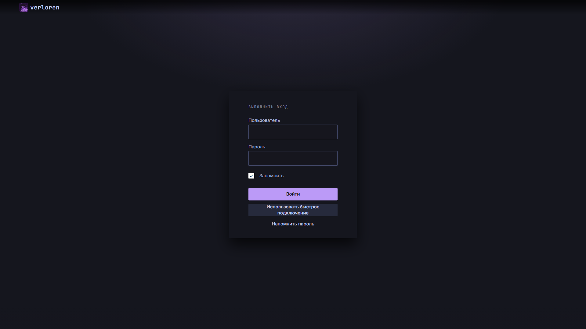
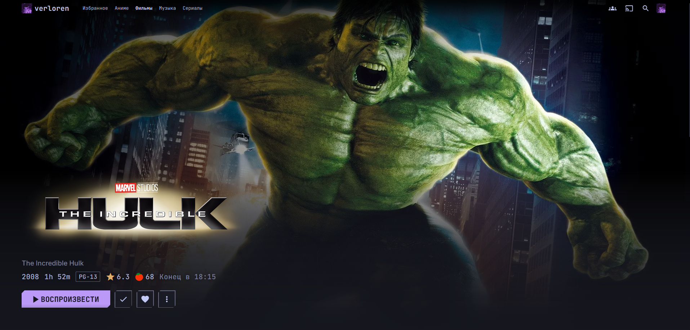
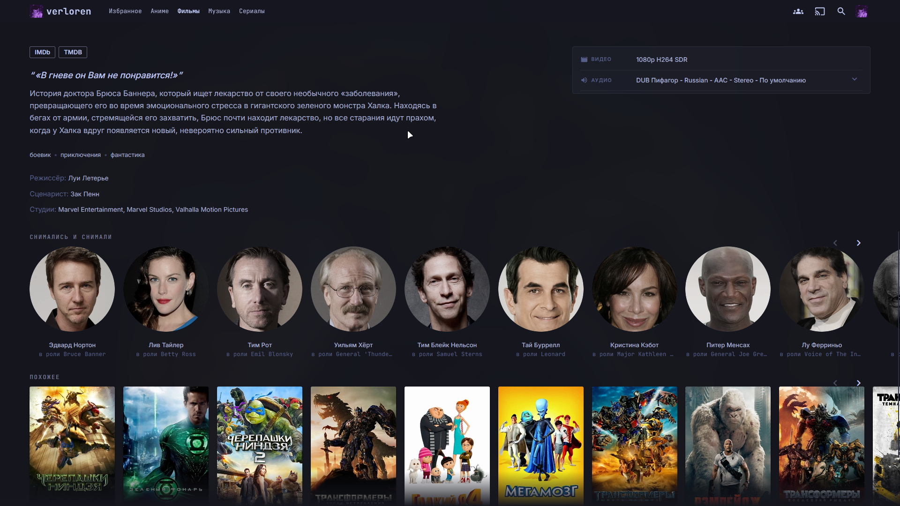
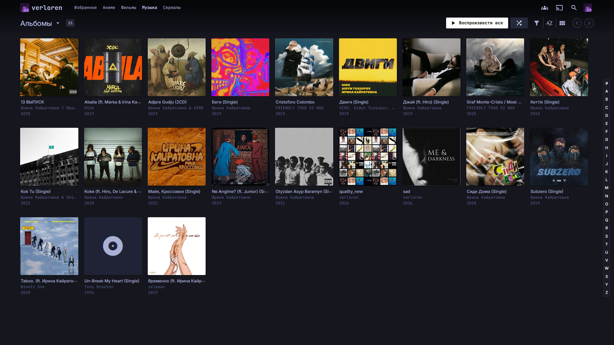

<h1 align="center">Theme qBittorrent | Jellyfin</h1>

<h3>Проект больше для сервероной части что бы интерфейс выгледил лучшее дефолтного,
jellyfin точно будет работать на версий 12.4,
qbittorrent будет работать точно на версий 5.1.4</h3>

<h2 align="center">PREVIEW</h2>

  
<h3>theme verloren jellyfin PC version</h3>

  

  
  
  
  
   
  
  
  
  
  
  
  
  

  
<h3>Phone version</h3>

  

  
  
  
  
  
  
  
  
  
  
  

