<h1 align="center">Theme qBittorrent | Jellyfin</h1>

[](https://jellyfin.org)
[](https://www.qbittorrent.org)
[](https://claude.ai)

Проект в основном для серверной части: чтобы интерфейс выглядел лучше стандартного.

- Jellyfin точно работает на версии 12.4.
- qBittorrent точно работает на версии 5.1.4.

<h2 align="center">Jellyfin</h2>

Тема точно работает на телефоне и на ПК. На телевизоре пока работает плохо.

- `netflin_jellyfin.css` взят за основу из проекта [Netflin](https://github.com/ahza-code/Netflin) и немного переделан. Это не мой основной стиль.
- `verloren_theme_jellyfin.css` тоже сделан на основе [Netflin](https://github.com/ahza-code/Netflin), но стиль взят из проекта [omaseed](https://github.com/diogochaves/omaseed). Было интересно их совместить, и получилось неплохо.

### Установка

1. Скопируйте содержимое нужного CSS-файла из папки `jellyfin_theme`.
2. Зайдите в панель управления Jellyfin, раздел «Оформление».
3. Вставьте код в поле «Настраиваемый CSS-код» и сохраните.

**Всё готово!**

<h2 align="center">qBittorrent</h2>

Стиль создан с помощью проекта [omaseed](https://github.com/diogochaves/omaseed).

### Установка

1. Создайте в удобном месте папку и запомните путь к ней.
2. Положите в неё все файлы из папки `qbittorrent_theme`.
3. Добавьте эту папку в `volumes` вашего Docker-контейнера qBittorrent. Формат: `путь_на_сервере:путь_в_контейнере:ro`.

   Пример:

   ```yaml
   volumes:
     - /srv/dev-disk-by-uuid-e430d7b8-ab9e-4de3-9b22-95d9a895d5e7/toshiba_1tb/qbittorrent/verloren:/config/verloren:ro
   ```

   Здесь `/srv/.../qbittorrent/verloren` — путь на сервере, а `/config/verloren` — путь внутри контейнера (в qBittorrent появится папка `verloren`).

4. Перезапустите контейнер:

   ```bash
   docker compose up -d
   ```

5. Откройте qBittorrent: Настройки → вкладка **WebUI** → включите **Use alternative WebUI**.
6. В поле пути укажите `/config/verloren`, нажмите **Save** и перезагрузите страницу.

**Всё готово!**

<h2 align="center">PREVIEW</h2>

<details>
  <summary><h3>Jellyfin theme verloren: PC version</h3></summary>
  <p>
  
  
  
  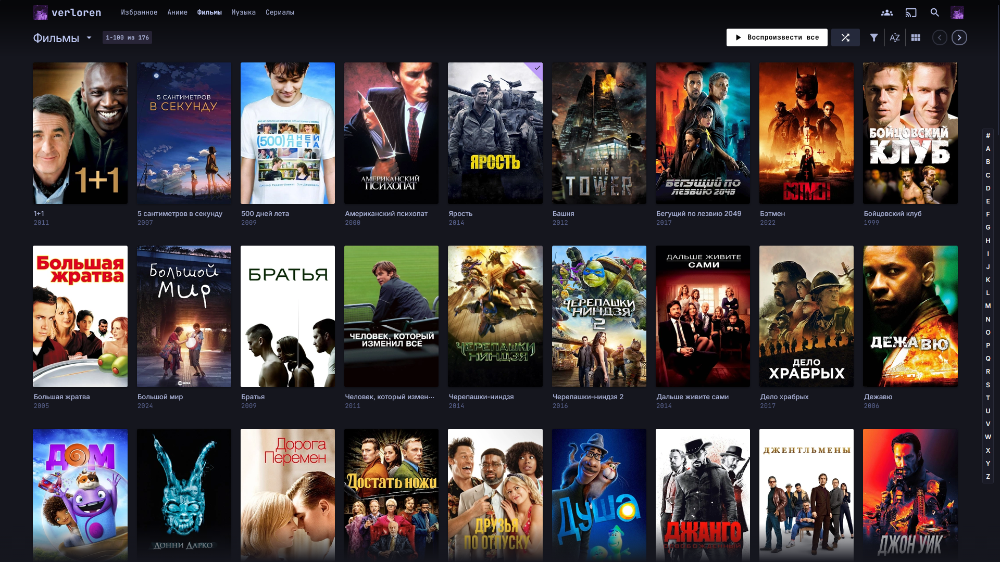
  
  
  
  
  
  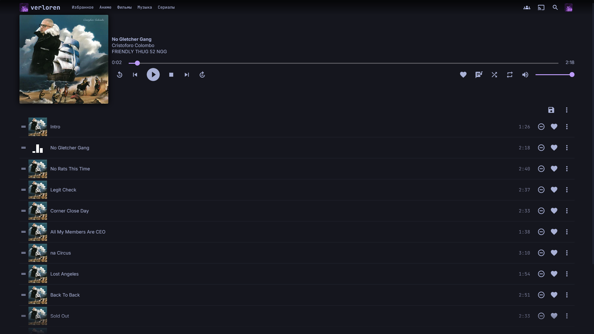
  
  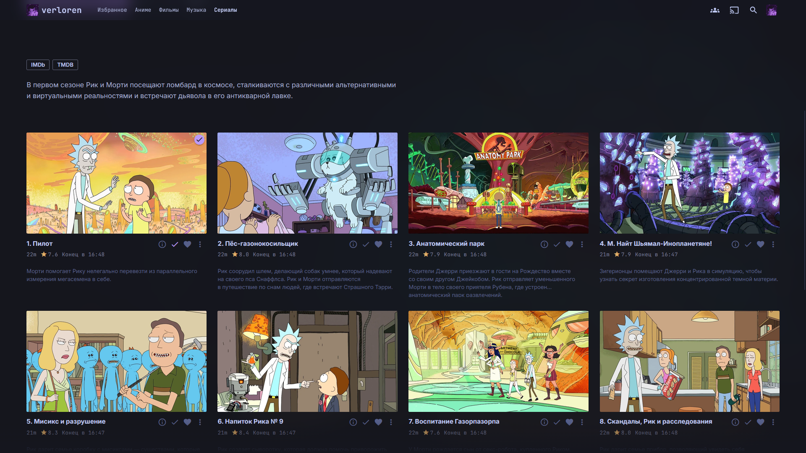
  </p>
</details>

<details>
  <summary><h3>Jellyfin theme verloren: Phone version</h3></summary>
  <p>
  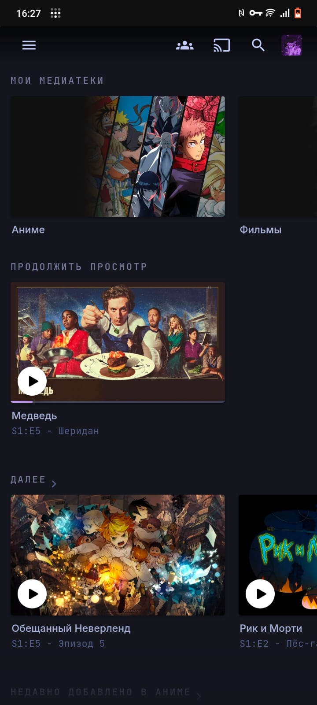
  
  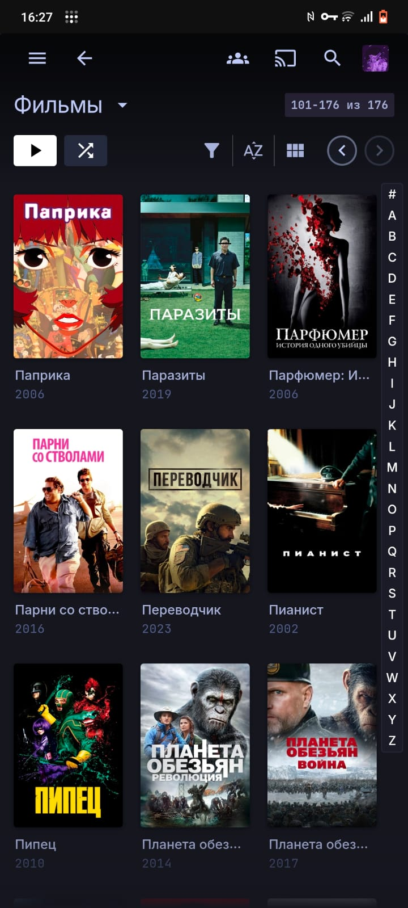
  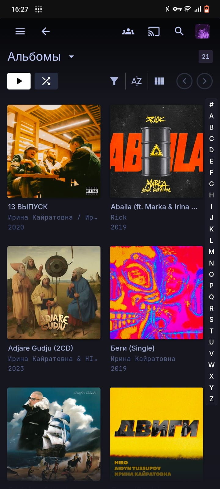
  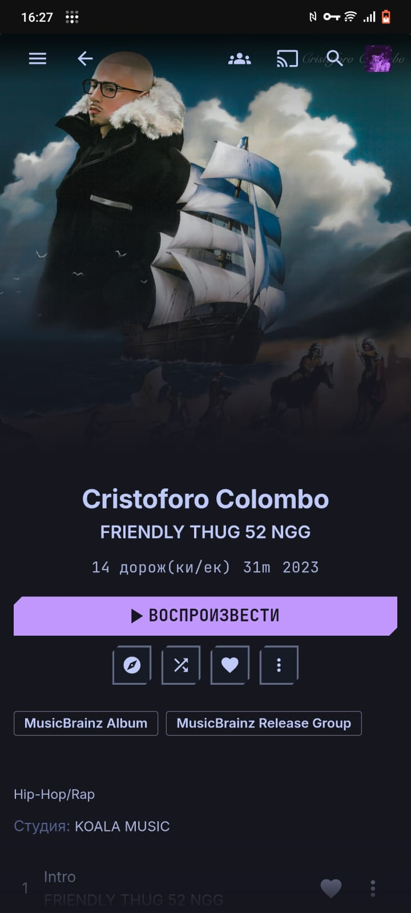
  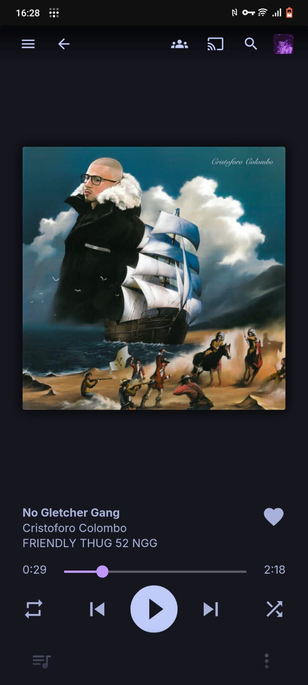
  
  
  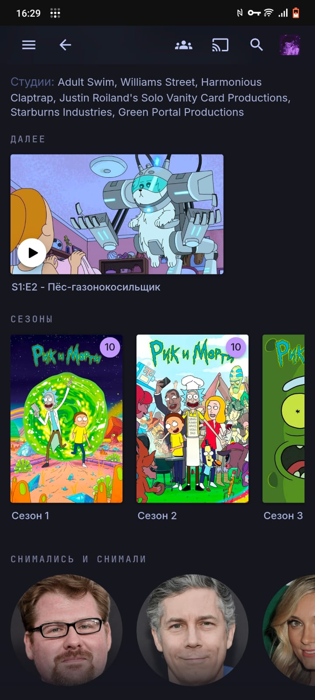
  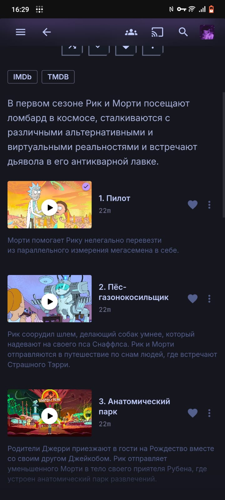
  </p>
</details>

<details>
  <summary><h3>qBittorrent theme</h3></summary>
  <p>
  
  
  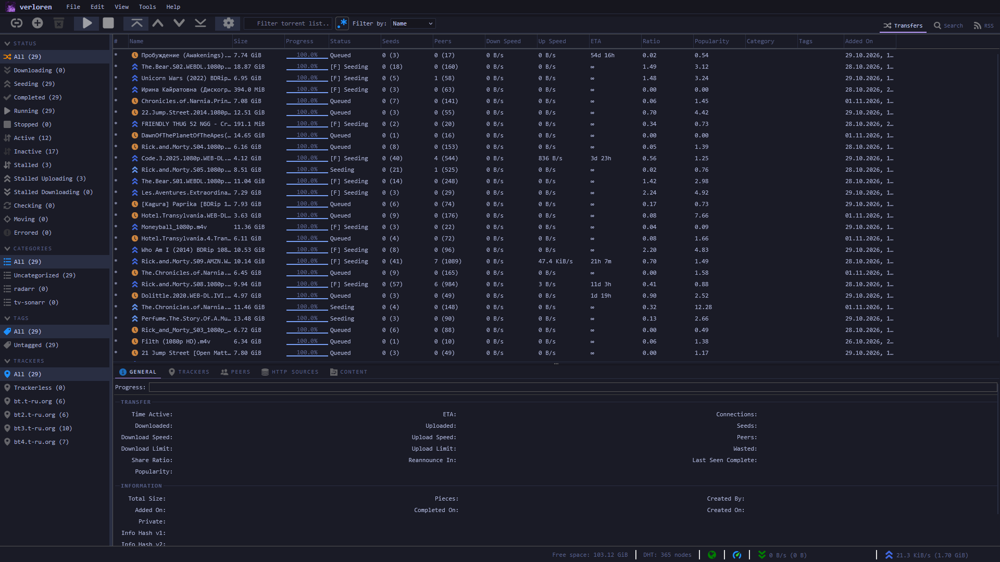
  </p>
</details>


## Лицензия и авторы

Проект распространяется под лицензией [GPL-2.0](LICENSE). Программное обеспечение предоставляется «как есть», без каких-либо гарантий. Автор не несёт ответственности за любые убытки или проблемы, возникшие при использовании кода.

Использованные проекты:

- [Netflin](https://github.com/ahza-code/Netflin) (GPL-2.0) — основа для `netflin_jellyfin.css` и `verloren_theme_jellyfin.css`
- [omaseed](https://github.com/diogochaves/omaseed) (MIT, Copyright (c) 2026 Diogo Chaves) — источник стиля для темы qBittorrent и Jellyfin verloren
