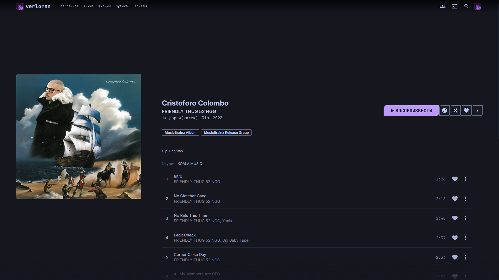
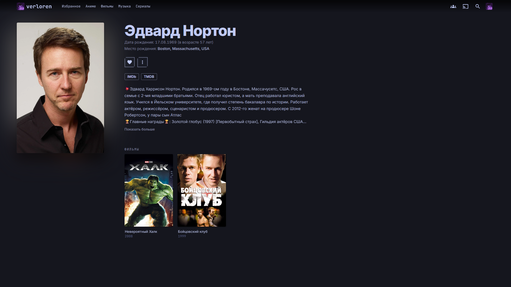
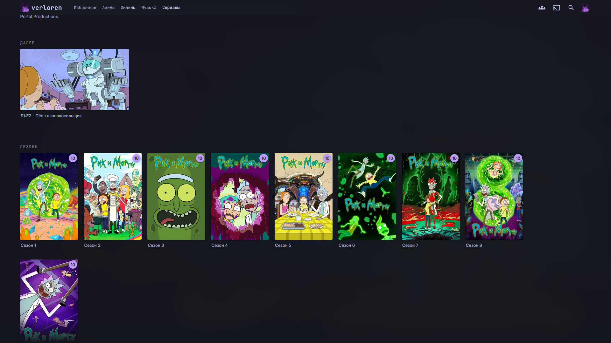
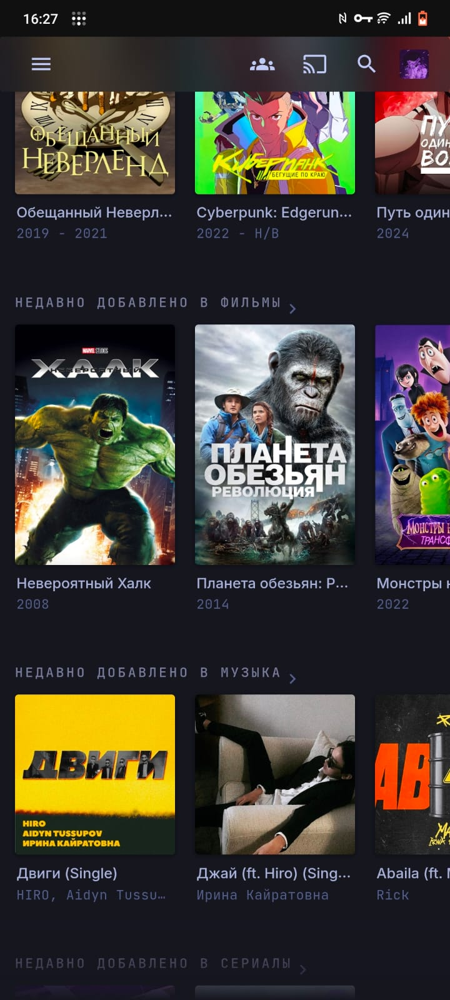
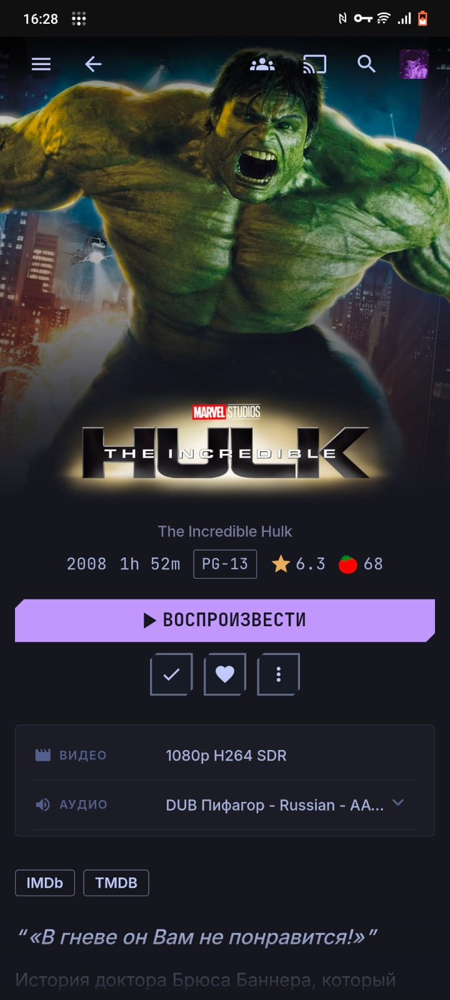
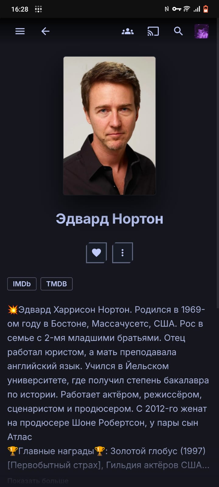

<h1 align="center">Theme qBittorrent | Jellyfin</h1>

<h3>Проект больше для сервероной части что бы интерфейс выгледил лучшее дефолтного,
jellyfin точно будет работать на версий 12.4,
qbittorrent будет работать точно на версий 5.1.4</h3>

<h2 align="center">Jellyfin объяснение</h2>
<h3>netflin_jellyfin.css взято за основу с этого проекта https://github.com/ahza-code/Netflin и немного переделан он не основной стиль</h3>
<h3>verloren_theme_jellyfin.css взят за основу тоже проект https://github.com/ahza-code/Netflin но уже стиль был как в этом проекте https://github.com/diogochaves/omaseed очень было интересно их совместит вышло не плохо</h3>

<h3>Что бы в jellyfin пременить мой стили надо просто скопировать что в css файлах в папке jellyfin_theme дальше надо зайти в панель управление есть оформление и туда просто вставляем мой css код в Настраиваемый CSS-код все готово </h3>

<h2 align="center"> qBittorrent объяснение</h2>
<h3>Стиль для проекта подобрать помог другой проект https://github.com/diogochaves/omaseed и было создано</h3>
<h3>Что бы использовать его надо создать папку где вам удобно запомнить путь в эту папку закинуть все файлы с папки qbittorrent_theme после зайти на свой docker контейнер и в volume добавит путь</h3>
<h3>Пример вот - /srv/dev-disk-by-uuid-e430d7b8-ab9e-4de3-9b22-95d9a895d5e7/toshiba_1tb/jellyfin/verloren:/config/verloren:ro мой путь тут /srv/dev-disk-by-uuid-e430d7b8-ab9e-4de3-9b22-95d9a895d5e7/toshiba_1tb/jellyfin/verloren и после него надо будет добавить всего :config/verloren:ro что бы в qbittorrent патом появился папка verloren </h3>
<h3>После этого надо перезапустить контейнер docker compose up -d и после зайти на qbittorrent</h3>
<h3>Настройки после в окне WebUI есть поле use alternative webui включаем патом просто вводим туда папку /verloren нажымаем save и все перезагружаем страницу</h3>
<h3>ВСЕ ГОТОВО</h3>

<h2 align="center">PREVIEW</h2>

  
<h3>theme verloren jellyfin PC version</h3>

  

  
  
  
  
   
  
  
  
  
  
  
  
  

  

  
<h3>Phone version</h3>

  

  
  
  
  
  
  
  
  
  
  
  

  

  
<h3>qbittorrent theme</h3>

  

  
  
  
  

